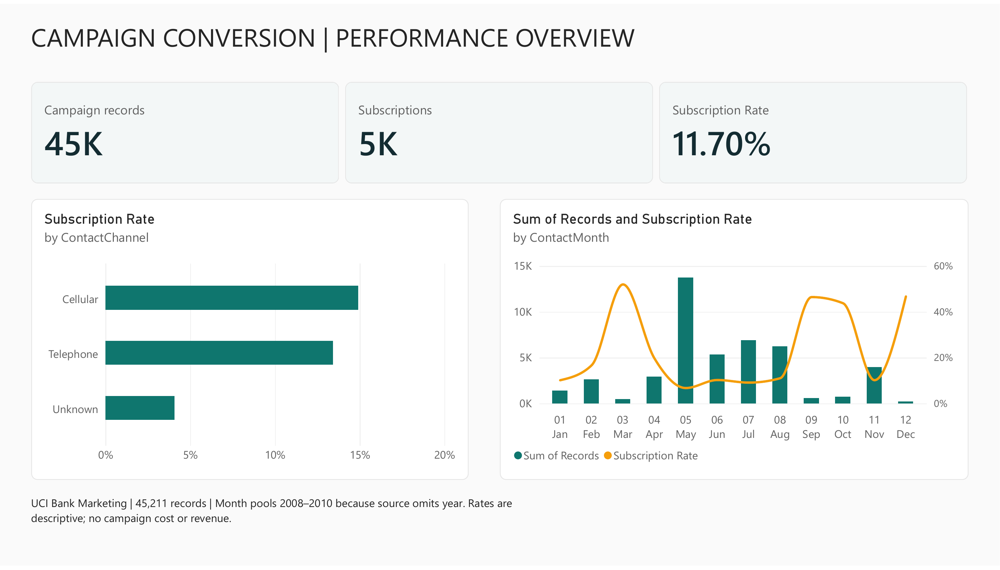
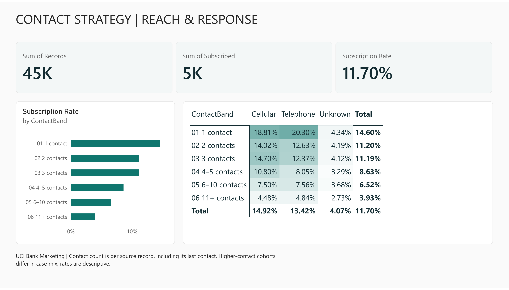
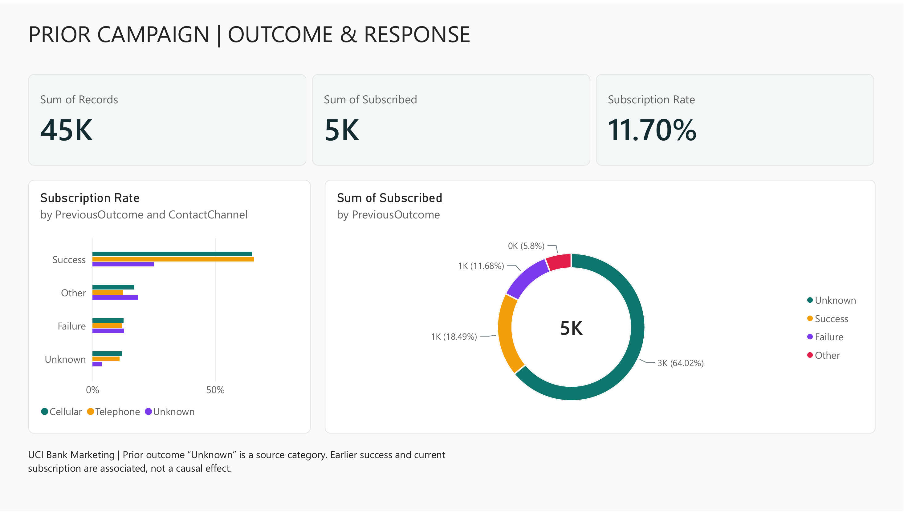

# Bank marketing | Power BI campaign analytics

A Power BI portfolio case study of historical term-deposit campaign records from the [UCI Bank Marketing dataset](https://archive.ics.uci.edu/dataset/222/bank+marketing). The report examines subscription outcomes across contact channels, campaign contact counts and prior campaign outcomes.

[Editable Power BI report](reports/bank-marketing.pbix) · [Three-page PDF](reports/bank-marketing.pdf) · [Findings](reports/findings.md) · [Business brief](docs/business-brief.md) · [Interaction guide](docs/interaction-guide.md)

The [live report and pinned KPI dashboard](docs/power-bi-links.md) are saved in Power BI. Workspace permissions may be required for those links; the PBIX, PDF and images below are available publicly here.

## Campaign overview



## Contact patterns



## Prior outcome and context



## Headline metrics

| KPI | Result |
| --- | ---: |
| Campaign records | 45,211 |
| Term-deposit subscriptions | 5,289 |
| Subscription rate | 11.70% |
| Reported campaign contacts per record | 2.76 |

Cellular contacts show a 14.92% observed subscription rate and records with a prior successful campaign outcome show 64.73%. These groups differ in history and composition; the dashboard does not establish channel or contact-count effects.

## Reproduce and inspect

```bash
python -m pip install -r requirements.txt
python scripts/analyze.py
```

The script preserves the original UCI source, builds `data/campaigns.csv`, exports segment summaries, and checks totals independently with SQLite. [Power Query](docs/PowerQuery.m), [DAX](docs/measures.dax) and the [report theme](docs/campaign-theme.json) document the live model. [Interaction guide](docs/interaction-guide.md) explains filters and chart selections.

## Attribution and limits

Moro, S., Rita, P., & Cortez, P. (2014). *Bank Marketing* [Dataset]. UCI Machine Learning Repository. [DOI 10.24432/C5K306](https://doi.org/10.24432/C5K306), CC BY 4.0. See [source and adaptation notes](data/SOURCE.md).

The legacy source describes records ordered across May 2008–November 2010, but gives month and day **without a calendar year**. Month visuals pool years and are not a chronological trend. Source `Unknown` categories are retained. The source lacks campaign cost, revenue, a unique customer key and random assignment. Findings are descriptive, not causal or a measured business outcome. This is an independent portfolio exercise, not client work. The PBIX preserves report interactions; images and PDF are static snapshots.
